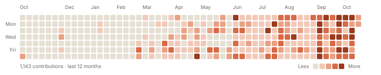
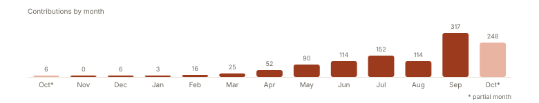

  

  

  Mobile engineer building <strong>offline-first Android &amp; iOS</strong> products —
  local-first data, hardware integration, and on-device intelligence.

  
  
  
  

---

## Now

- **AuraSpend** — open-source expense parsing that runs entirely on-device
- **Bolt v2** — rental operations for power-tool shops, private build
- **ZenTask** — RPG-style task manager, in closed testing

## Selected work

### AuraSpend · on-device expense parsing

<code>Kotlin</code> <code>Compose</code> <code>MVI</code> <code>Room</code> <code>ONNX</code> · Android · AGPL-3.0 · <a href="https://github.com/auraspend/auraspend">source</a> · <a href="https://abhijithwarrier.com/auraspend/">case study</a>

Bank SMS in, structured transactions out — no server, no telemetry, no ads.

**Constraint** — It has to run on mid-range phones, and a wrong call *deletes a real debit*. A 468 MB decoder pushed through the same pipeline removed 8 of 46 real transactions by mistaking them for OTPs.

**Approach** — Sender-routed regex parsers own amount, merchant and date. A 22 MB int8 MiniLM encoder fills only what's left: category, subscription, income-vs-expense. `AiSignalFusion` lets the parser veto the model, and the model may never discard a transaction on its own. The download is consent-gated, resumable and SHA-256 verified.

**Result** — Fully offline, 22 MB instead of 468 MB, zero false deletions across the eval set.

Engineering notes

- Sender-routed parsers per bank (Axis, Canara, SBI) resolve messages that carry both a real amount and a decoy available-limit figure
- Budgets, recurring subscriptions, Canvas-drawn analytics, CSV import/export, Drive backup
- Light, dark and true-black AMOLED themes; AGPL-3.0 with CI on every push

### Bolt · offline-first rental operations

<code>Kotlin</code> <code>Compose</code> <code>Hilt</code> <code>Room</code> <code>Firebase</code> <code>CameraX</code> · Android · private build · <a href="https://abhijithwarrier.com/bolt/">case study</a>

A business-in-a-box for Indian power-tool shops: rentals, repairs, inventory, CRM and finance.

**Constraint** — Shop floors have unreliable connectivity, and nine entity types have to stay consistent across rentals, repairs, bookings and transactions.

**Approach** — Room is the source of truth. Every write lands locally first and WorkManager reconciles with Firestore in the background. CameraX captures damage evidence at handover, and a community suspicious-contact registry scores repeat-fraud risk across shops.

**Result** — Runs the shop's day-to-day operations end to end. Commercial build, no public listing.

Entity model

Rentals · repairs · inventory · CRM · bookings · transactions · sales · notifications · brands

### Hydra · gamified hydration tracking

<code>Kotlin</code> <code>Compose</code> <code>Clean Arch</code> <code>Hilt</code> <code>Room</code> <code>Health Connect</code> · Android · 4.9★ · 1,000+ downloads · <a href="https://play.google.com/store/apps/details?id=com.awbuilds.hydra">Google Play</a> · <a href="https://abhijithwarrier.com/hydra/">case study</a>

A hydration tracker that adapts its goal to the weather and keeps reminders alive through Doze.

**Constraint** — Reminders must land on time without a foreground service, and goals have to react to outdoor temperature without draining the battery.

**Approach** — Dual scheduling with WorkManager and AlarmManager so reminders survive Doze. Weather is fetched on a coarse interval and cached, with GPS only when a goal is recalculated. The progress indicator is a three-layer sine wave drawn on Canvas — no animation library, no image assets.

**Result** — 4.9★ across 1,000+ installs, localized into 60+ locales, with Drive backup and Health Connect sync.

**ZenTask** — RPG-style task manager: 100 rank tiers across 11 titles, a quadratic XP engine, four Pomodoro presets, task dependencies, recurring tasks and Drive sync · 7 locales · closed testing · [case study](https://abhijithwarrier.com/zentask/)

## How I build

- **Local-first is the default.** Room is the source of truth; sync is a background concern, never a UI blocker.
- **Deterministic before probabilistic.** Regex and state machines own the facts; models fill gaps and can be overruled.
- **Battery and lifecycle are correctness.** Doze-proof scheduling, process-death recovery, no leaked collectors.
- **Tests that run offline.** No network in unit tests, and Compose UI tests for the paths that actually break.

## Stack

  <picture>
    <source media="(prefers-color-scheme: dark)" srcset="https://skillicons.dev/icons?i=kotlin,java,swift,androidstudio,xcode,gradle,firebase,git,github,postman,figma,sqlite&perline=12&theme=dark">
    
  </picture>

- **Android** — Kotlin, Jetpack Compose, Material 3, Coroutines & Flow, Hilt, Room, WorkManager
- **iOS** — Swift, SwiftUI, UIKit, async/await, Core Bluetooth
- **Architecture** — MVVM, MVI, Clean Architecture, modularisation, SOLID
- **Data & cloud** — Room, DataStore, Retrofit, OkHttp, Firebase, Drive API, Cloudflare R2
- **Hardware & on-device** — USB, LoRa, BLE, firmware parsing, binary decoding, CameraX, Health Connect, ONNX Runtime
- **Testing & delivery** — JUnit, Mockito, Espresso, Compose UI Test, XCTest, GitHub Actions

## Experience

| Period | Role | Company |
|--------|------|---------|
| Nov 2025 – Present | **Mobile App Developer** | Digitide Solutions Ltd. |
| Jun 2022 – Nov 2025 | **Android App Developer** | Primemover Solutions Pvt Ltd. |
| Sep 2021 – Nov 2021 | Data Annotator for AI | Digiyoda Media Pvt Ltd. |

## Activity

  <picture>
    <source media="(prefers-color-scheme: dark)" srcset="assets/contributions-dark.svg">
    
  </picture>

  <picture>
    <source media="(prefers-color-scheme: dark)" srcset="assets/activity-dark.svg">
    
  </picture>

---

  Kerala, India · Open to remote and hybrid mobile roles · <a href="https://abhijithwarrier.com/">abhijithwarrier.com</a>

